# SecureBiz-Lab — Demonstration Scenarios

## 1. Purpose and Scope

This document defines practical demonstration scenarios for SecureBiz-Lab.

The scenarios are designed to demonstrate the application's security controls through its API, PostgreSQL security mechanisms, Vault integration, and CI/CD workflows.

The demonstrations must be performed in a dedicated test environment using authorized test accounts and non-production data.

The following distinction must be maintained throughout the demonstration:

- **Implemented:** a feature or security control is present in the source code or database migration.
- **Verified:** a corresponding automated check or controlled test has been executed successfully.
- **Demonstrated:** the behavior has been observed during a live demonstration.

The presence of an implementation does not, by itself, prove that every possible attack scenario has been successfully tested.

## 2. Demonstration Prerequisites

### 2.1 Required environment

Before starting, ensure that the following components are available:

- SecureBiz-Lab FastAPI application.
- PostgreSQL database with the required migrations applied.
- HashiCorp Vault with the `securebiz-context` Transit key provisioned.
- A valid test user account.
- An active organization membership for that user.
- A test organization accessible to the account.
- A test environment in which authentication and authorization scenarios can be performed safely.

The API base URL must be obtained from the actual runtime configuration.

The API is exposed locally through Docker Compose at:

`http://127.0.0.1:8000`

The API container listens on port `8000`, published on the host interface
`127.0.0.1`. The health endpoint has been verified and returned HTTP 200.

### 2.2 Test credentials

Use a dedicated test account.

The password must be provided orally or through an approved secret-sharing mechanism. It must never be written into this document, committed to Git, or included in terminal screenshots.

The following placeholders are used:

- `<test-email>`: email address of the authorized test account.
- `<password>`: test account password.
- `<access-token>`: access JWT returned by the login endpoint.
- `<org-id>`: UUID of the test organization.

Never use production credentials for these demonstrations.

### 2.3 Retrieve the organization identifier dynamically

The organization identifier must not be copied from a hardcoded UUID in the documentation.

An administrator can retrieve available organizations using a read-only SQL query:

```sql
SELECT id, name, slug
FROM public.organizations
ORDER BY name;
```

To identify the organization associated with a specific test account, use:

```sql
SELECT
    u.id AS user_id,
    u.email,
    u.status AS user_status,
    o.id AS organization_id,
    o.name AS organization_name,
    m.status AS membership_status
FROM public.users AS u
JOIN public.memberships AS m
    ON m.user_id = u.id
JOIN public.organizations AS o
    ON o.id = m.organization_id
WHERE u.email = '<test-email>'
ORDER BY o.name;
```

Use an organization for which the user and membership are active.

These queries are read-only. They must not be replaced with manual database modifications during the demonstration.


### 2.6 IAM demonstration data — Execution results

The demonstration IAM seed script was executed successfully:

`docker compose run --rm -it --entrypoint python api /app/scripts/seed_demo_iam.py`

The script created or confirmed the following demonstration setup in `Test Org`:

| Account | User status | Membership status | Assigned role |
|---|---|---|---|
| `demo-owner@securebiz-lab.test` | Active | Active | owner |
| `demo-member@securebiz-lab.test` | Active | Active | member |

The existing `test-user@test.com` account was also confirmed active.

The resulting role assignments were verified through read-only PostgreSQL queries:

- **owner:** 11 permissions.
- **member:** 2 permissions (`roles:read`, `users:read`).

The seed execution reported success and returned the organization, user, role, and membership identifiers.

**Credential provisioning status:** The seed script did not create authentication credentials. The demonstration accounts cannot be considered ready for login until their passwords have been provisioned through the approved provisioning procedure.

These results confirm the IAM seed execution and database assignments. They do not yet demonstrate successful API authentication or authorization.

## 3. Scenario 1 — Authentication Lifecycle

### Objective

Demonstrate user authentication, access-token issuance, refresh-token handling, and logout.

### 3.1 Login

The application exposes:

`POST /auth/login`

Request:

```bash
curl.exe -i -c cookies.txt ^
  -H "Content-Type: application/json" ^
  -d "{\"email\":\"<test-email>\",\"password\":\"<password>\"}" ^
  http://127.0.0.1:8000/auth/login
```

Expected behavior:

- Valid credentials are accepted.
- The response contains an access token.
- The response includes the token type and expiration information.
- The refresh token is delivered through an HTTP cookie.
- The refresh token is not returned as a normal JSON response field.

The cookie jar must be protected because it contains authentication material.

Expected response fields include:

- `access_token`
- `token_type`
- `expires_in`

### 3.1.1 Execution results

Two demonstration accounts were used to validate the login endpoint:

| Account | Email | Result |
|---|---|---|
| Organization owner | `demo-owner@securebiz-lab.dev` | Successful |
| Organization member | `demo-member@securebiz-lab.dev` | Successful |

Observed results for both accounts:

- Authentication succeeded through `POST /auth/login`.
- The response issued a bearer access token.
- `expires_in` was `900` seconds (15 minutes).
- A refresh cookie was present in the response.
- The access token and refresh-cookie values were not included in the documentation.

Evidence captures:

- Owner login: `docs/07-rapports/captures/S1-login-success.png`
- Member login: `docs/07-rapports/captures/S1-login-success-member.png`

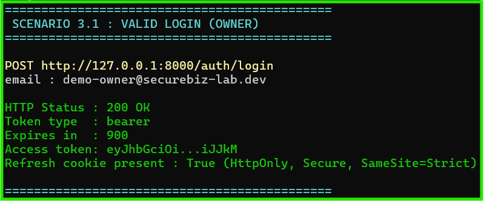

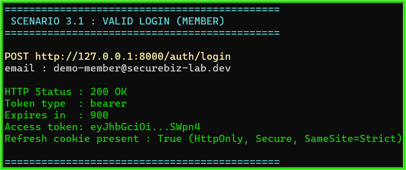

These results demonstrate successful authentication and token issuance for both account roles. The presence of the refresh cookie was observed; its `HttpOnly`, `Secure`, and `SameSite` attributes have not yet been independently verified. Refresh-token rotation and logout are documented as separate demonstrations and are not claimed as tested here.

### 3.2 Invalid credentials

Submit a login request using an incorrect password.

Expected behavior:

- Authentication is rejected.
- The API returns HTTP 401.
- The response uses the generic message `Invalid credentials.`

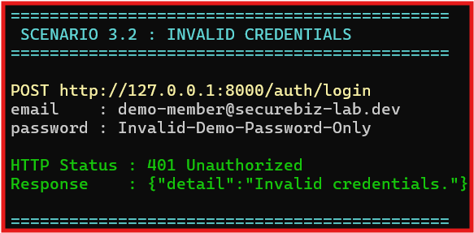

The application also performs a dummy Argon2 password verification when an email address is unknown. This is an implementation measure intended to reduce account-enumeration timing differences.

It must not be presented as proof of perfectly equal response times unless a dedicated timing assessment has been performed.

### 3.3 Access a protected endpoint

Use the access token returned by the login request.

Example:

```bash
curl.exe -i ^
  -H "Authorization: Bearer <access-token>" ^
  -H "X-Organization-Id: <org-id>" ^
  http://127.0.0.1:8000/organizations/me
```

Expected behavior:

- The JWT is validated.
- The organization header is processed.
- The application attempts to establish the authenticated tenant context.
- The organization response is restricted by the active tenant context and PostgreSQL RLS.

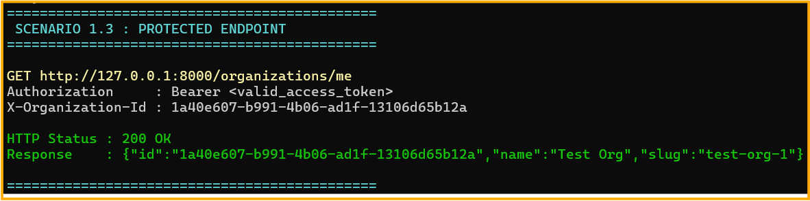

### 3.4 Refresh the access token

The application exposes:

`POST /auth/refresh`

The refresh token is read from the HTTP cookie.

```bash
curl.exe -i -b cookies.txt -c cookies.txt ^
  -X POST ^
  http://127.0.0.1:8000/auth/refresh
```

Expected behavior:

- The refresh cookie is accepted.
- The previous refresh token is revoked.
- A new refresh token is issued in the cookie.
- A new access token is returned.

The cookie jar is updated to contain the new refresh token.

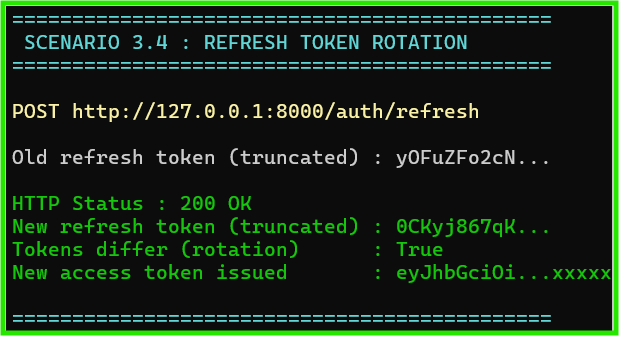

### 3.5 Logout

The application exposes:

`POST /auth/logout`

```bash
curl.exe -i -b cookies.txt -c cookies.txt ^
  -X POST ^
  http://127.0.0.1:8000/auth/logout
```

Expected behavior:

- The refresh-token family associated with the cookie is revoked.
- The refresh cookie is cleared.
- The API returns the logout status.

A successful logout must not be interpreted as proof that an already issued access JWT has been individually revoked. Access-token validation and refresh-token revocation are separate mechanisms.

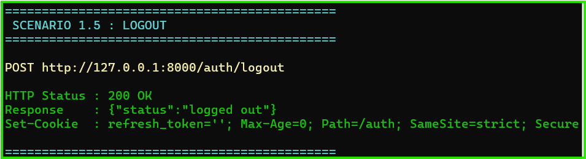

## 4. Scenario 2 — Refresh Token Rotation and Replay Detection

### Objective

Demonstrate refresh-token rotation and the detection of refresh-token reuse.

### Security mechanism

Refresh tokens are generated as opaque random values.

The database stores their SHA-256 hashes rather than their raw values.

The refresh service:

- Creates a token family during login.
- Revokes the previous token during a successful rotation.
- Links the replaced token to its successor.
- Uses family-level locking to coordinate rotation and revocation.
- Detects reuse of a revoked token.
- Revokes the remaining active tokens in the affected family when reuse is detected.

### Demonstration procedure

Perform this scenario only with a disposable test account.

1. Log in and save the returned cookie jar as `cookies.txt`.
2. Copy the cookie jar to `stale-cookies.txt` before refreshing.
3. Perform a refresh using `cookies.txt`.
4. Confirm that the current cookie jar has been updated.
5. Attempt another refresh using the old `stale-cookies.txt` cookie jar.

The old cookie jar represents a previously valid refresh token that has already been rotated.

Example:

```powershell
Copy-Item .\cookies.txt .\stale-cookies.txt

curl.exe -i -b .\cookies.txt -c .\cookies.txt `
    -X POST http://127.0.0.1:8000/auth/refresh

curl.exe -i -b .\stale-cookies.txt -c .\stale-cookies.txt `
    -X POST http://127.0.0.1:8000/auth/refresh
```

Expected behavior:

- The first refresh succeeds.
- The replay attempt is rejected.
- The affected token family is revoked by the refresh service.

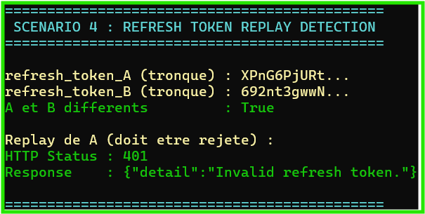

After the replay demonstration, the test account must authenticate again to obtain a new refresh-token family.

Do not display, copy into documentation, or publish the raw refresh token.

Delete the temporary cookie files securely according to the test environment's data-handling procedure.

## 5. Scenario 3 — Multi-Tenant Context and Isolation

### Objective

Demonstrate that authenticated access is associated with a specific organization and that tenant membership is verified before tenant context is installed.

### Security mechanism

The application obtains the user identity from the validated JWT.

The organization identifier is supplied through:

`X-Organization-Id`

The application does not treat the header alone as proof of membership.

Instead, the tenant-context dependency:

1. Validates the authenticated user.
2. Reads and validates the organization identifier.
3. Creates a signed tenant-context payload.
4. Requests a signature from Vault Transit.
5. Calls the PostgreSQL context-installation function.
6. Relies on PostgreSQL to verify the signature and membership.
7. Makes the context available to database RLS policies for the transaction.

### Demonstration A — Valid membership

```bash
curl.exe -i ^
  -H "Authorization: Bearer <access-token>" ^
  -H "X-Organization-Id: <org-id>" ^
  http://127.0.0.1:8000/organizations/me
```

Expected behavior:

- The authenticated identity is accepted.
- The tenant context is installed.
- The organization endpoint returns the organization visible to the authenticated tenant context.

### Demonstration B — Missing organization header

```bash
curl.exe -i ^
  -H "Authorization: Bearer <access-token>" ^
  http://127.0.0.1:8000/organizations/me
```

Expected behavior:

- The request is rejected with HTTP 400 because the organization header is missing.

### Demonstration C — Invalid organization identifier

```bash
curl.exe -i ^
  -H "Authorization: Bearer <access-token>" ^
  -H "X-Organization-Id: invalid-uuid" ^
  http://127.0.0.1:8000/organizations/me
```

Expected behavior:

- The request is rejected with HTTP 422 because the organization identifier is not a valid UUID.

### Demonstration D — Unauthorized membership

Use a valid organization identifier for which the test user has no active membership.

Expected behavior:

- PostgreSQL refuses to install the tenant context.
- The application maps the recognized authorization refusal to HTTP 403.

This test must use an organization and account combination whose membership status has been checked beforehand.

Do not modify membership records to manufacture the result during the demonstration.

### Execution results

The following results were obtained during the live demonstration:

| Test | Input or action | Observed result |
|---|---|---|
| A | Authenticated user with active membership in Test Org | HTTP 200 |
| B | Missing `X-Organization-Id` header | HTTP 400 |
| C | Malformed organization identifier (`invalid-uuid`) | HTTP 422 |
| Organization setup | Created `Demo Org B` (`demo-org-b`), ID `9ee261a1-16a7-41f1-ace7-7734975dbd76` | PostgreSQL returned `INSERT 0 1` |
| D | `demo-member` token used with the existing Demo Org B, without active membership | HTTP 403 |

The unauthorized-membership test confirms that a user without active membership cannot establish the requested organization context through the API.

These results demonstrate tenant-membership enforcement at the API context-installation boundary. They do not, by themselves, constitute an exhaustive verification of every PostgreSQL Row-Level Security policy.

## 6. Scenario 4 — PostgreSQL Row-Level Security and RBAC

### Objective

Demonstrate how PostgreSQL Row-Level Security (RLS), tenant context enforcement, and Role-Based Access Control (RBAC) work together to restrict access to organization data.

This scenario documents the implemented database security mechanisms, the verified role and permission assignments, and the observed API authorization results for the demonstration accounts.

### Security mechanism

The database migration enables and forces Row-Level Security on the following tables:

- `public.organizations`
- `public.users`
- `public.memberships`
- `public.roles`
- `public.membership_roles`
- `public.role_permissions`

The `auth_security.app_has_permission()` database function evaluates permissions using the authenticated tenant context and the active membership's assigned roles.

The function checks:

- The existence of an active membership.
- The organization associated with that membership.
- The roles assigned to the membership.
- The organization-scoped role records.
- The role-permission assignments.
- The requested permission code.

These mechanisms are designed to ensure that database access is evaluated in the context of the authenticated user, the selected organization, and the permissions assigned through the user's active membership.

### Verification status

The following implementation and demonstration results have been established:

- RLS policies: **IMPLEMENTED** (database migration).
- Role and permission assignments: **VERIFIED** (SQL, see sections 2.3 and 2.6).
- API authorization for the tested read permissions: **DEMONSTRATED** (HTTP 200 for both demonstration roles).
- Tenant context enforcement at the API level: **DEMONSTRATED** (HTTP 403 for an organization without an active membership, see section 5).

The HTTP results demonstrate the behavior of the exposed API endpoints. They do not independently establish the behavior of every PostgreSQL RLS policy under direct database access.

### Demonstration A — List organization roles

The API exposes the following endpoint:

`GET /roles`

This endpoint is used to retrieve the roles visible within the current organization context.

Request (PowerShell):

```powershell
curl.exe -i `
  -H "Authorization: Bearer <access-token>" `
  -H "X-Organization-Id: <org-id>" `
  http://127.0.0.1:8000/roles
```

Observed behavior:

- `demo-owner`: HTTP 200 OK.
- `demo-member`: HTTP 200 OK.

Both demonstration roles have the `roles:read` permission.

The endpoint successfully responds for both accounts when a valid authenticated tenant context is supplied.

Status: **DEMONSTRATED**.

### Demonstration B — List organization users

The API exposes the following endpoint:

`GET /users`

This endpoint is used to retrieve users visible within the current organization context.

Request (PowerShell):

```powershell
curl.exe -i `
  -H "Authorization: Bearer <access-token>" `
  -H "X-Organization-Id: <org-id>" `
  http://127.0.0.1:8000/users
```

Observed behavior:

- `demo-owner`: HTTP 200 OK.
- `demo-member`: HTTP 200 OK.

Both demonstration roles have the `users:read` permission.

The endpoint successfully responds for both accounts when a valid authenticated tenant context is supplied.

Status: **DEMONSTRATED**.

### Demonstration C — Compare permission assignments

Two authorized test accounts with different role assignments are used:

| Account | Role | Permissions |
|---|---|---|
| `demo-owner@securebiz-lab.dev` | `owner` | 11 permissions |
| `demo-member@securebiz-lab.dev` | `member` | 2 permissions (`roles:read`, `users:read`) |

The permission assignments are documented in section 2.3 and verified by SQL in section 2.6.

RBAC test results:

| Role | `GET /roles` | `GET /users` |
|---|---|---|
| `owner` | 200 OK | 200 OK |
| `member` | 200 OK | 200 OK |

Both roles possess `roles:read` and `users:read`, so the API correctly authorizes both for these read operations.

Status: **DEMONSTRATED**.

> **[CAPTURE — S4-RBAC]** Captured: 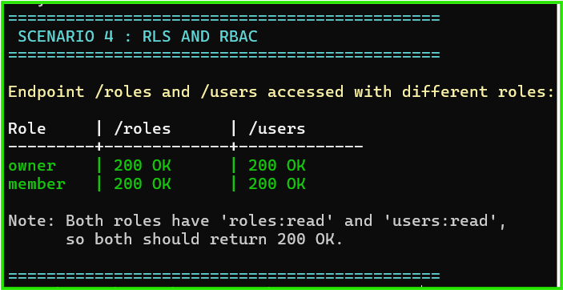 — Captured 2026-11-17

### Demonstration D — Multi-tenant isolation (Scenario 5)

A second organization `Demo Org B` (UUID `9ee261a1-16a7-41f1-ace7-7734975dbd76`) was created. The demonstration user `demo-member` is not a member of `Demo Org B`.

The multi-tenant test results:

| Test | Description | HTTP Status |
|---|---|---|
| A | Valid context (`Test Org`, `demo-owner`) | 200 OK |
| B | Missing `X-Organization-Id` header | 400 Bad Request |
| C | Invalid organization UUID | 422 Unprocessable Entity |
| D | Unauthorized membership (`Demo Org B`, `demo-member`) | 403 Forbidden |

The 403 response demonstrates that the API tenant-context layer refuses access to an organization the authenticated user does not belong to. This establishes access control at the API level. It does not, by itself, constitute proof that PostgreSQL RLS policies blocked a direct SQL read; that would require a separate database-level test.

Status: **DEMONSTRATED**.

> **[CAPTURE — S3-MULTI-TENANT]** Captured: 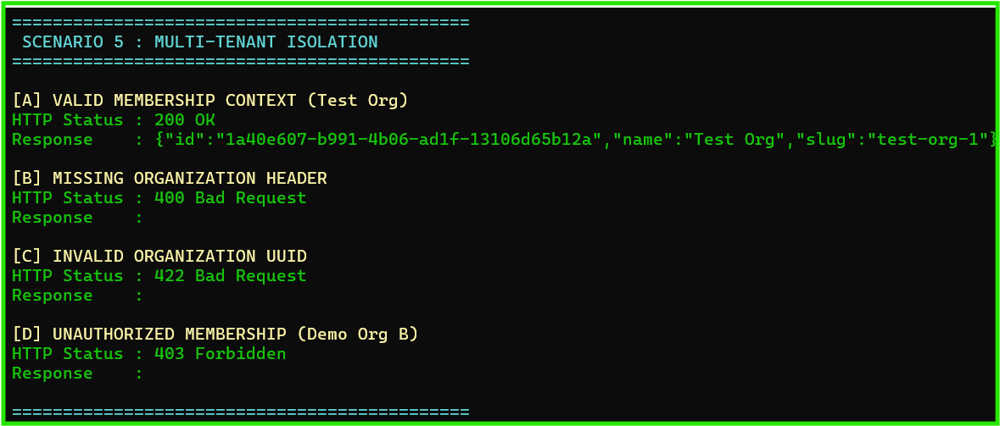 — Captured 2026-11-17

**API scope limitation:** the inspected FastAPI routes expose `GET /roles` and `GET /users`. The existence of SQL policies for role creation, modification, or deletion does not mean that corresponding role-management API endpoints are currently exposed.

Do not demonstrate or document role creation through the API unless such a route is implemented and independently verified.

## 7. Scenario 5 — Vault Transit and Signed Tenant Context

### Objective

Explain and verify the cryptographic trust mechanism used to establish a tenant context between the API and PostgreSQL.

### Security mechanism

Vault Transit uses the key:

`securebiz-context`

The key uses Ed25519 signing.

The private key remains inside Vault. The API requests signatures through the Vault Transit API and does not receive the private key.

The PostgreSQL function:

`auth_security.securebiz_install_context(...)`

validates the signed context before installing it.

The database-side validation includes:

- Required input validation.
- Maximum payload size of 8192 bytes.
- Exact signature length of 64 bytes.
- Verification against an active public key.
- Signature verification before JSON parsing.
- Validation of required claims.
- Issuer validation: `securebiz-api`.
- Audience validation: `securebiz-postgres`.
- UUID and timestamp validation.
- Maximum context lifetime of 60 seconds.
- Active user, membership, and organization checks.
- Replay detection through the JTI.
- Transaction-context installation.

The database records used for replay and transaction-context management include:

- `auth_security.used_jti`
- `auth_security.transaction_context`

### Demonstration procedure

Use the valid-membership request from Scenario 3.

Explain the sequence:

1. FastAPI validates the JWT.
2. FastAPI constructs the tenant-context payload.
3. Vault Transit signs the payload.
4. FastAPI sends the payload and signature to PostgreSQL.
5. PostgreSQL verifies the signature and claims.
6. PostgreSQL validates membership and organization status.
7. PostgreSQL records the JTI and installs the transaction context.
8. RLS policies use that context to restrict data access.

### Verification boundary

The implementation and the positive context-installation check in `scripts/state_check.py` provide evidence that the valid signed-context flow is implemented and checked.

They do not, by themselves, prove that a live demonstration of every negative case has been performed.

In particular, a tampered-signature or forged-context attack must not be described as a successfully executed demonstration unless a dedicated test has actually been run and its result recorded.

## 8. Scenario 6 — CI/CD Security Controls

### Objective

Demonstrate the automated checks used to detect application defects and security issues during development.

### Current status

- Workflows: **IMPLEMENTED** (`.github/workflows/ci.yml` and `security.yml`).
- CI execution (host tests): **DEMONSTRATED** (GitHub Actions run history).
- Bandit (SAST): **DEMONSTRATED** (GitHub Actions run history).
- pip-audit (dependency scan): **DEMONSTRATED** (GitHub Actions run history).

### Workflows inspected

- `ci.yml`: Python 3.12 and 3.13, compileall, 5 test files, `-W error::DeprecationWarning`.
- `security.yml`: Bandit 1.9.4 (`-ll -iii`), pip-audit 2.10.1.

### Execution evidence

The GitHub Actions interface shows 5 recent runs of the `SecureBiz Lab Security` workflow:
- Run #1: Failure (initial setup).
- Run #2: Success (resolved Bandit B310 and pip-audit CVEs).
- Run #3: Success.
- Run #4: Success (hardened Docker image).
- Run #5: Success (security headers middleware).

> **[CAPTURE — S6-CI-WORKFLOW]** Captured: 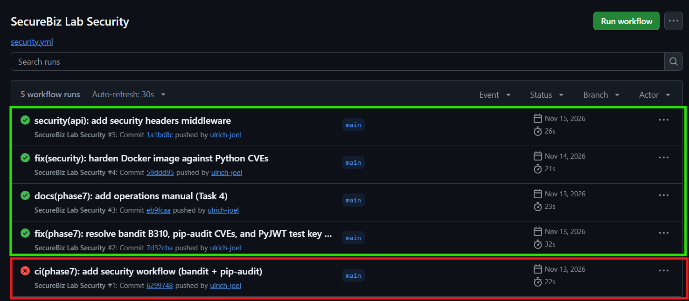 — Captured 2026-11-17

> **[CAPTURE — S6-CI-HOST-TESTS]** Captured: 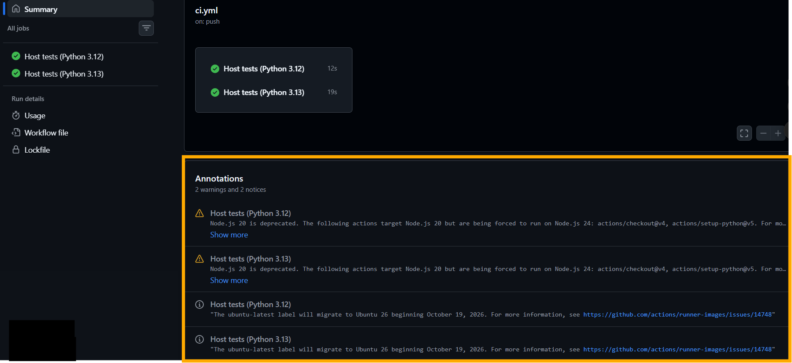
> Shows both `Host tests (Python 3.12)` and `Host tests (Python 3.13)` jobs passing.

Status: **DEMONSTRATED**.

## 9. Scenario 7 — Vault Secret Management

### Objective

Demonstrate that sensitive cryptographic material is managed through Vault rather than embedded in the application source code.

### Current status

- Vault Transit key `securebiz-context`: **VERIFIED** (Ed25519, `exportable: false`).
- Vault KV-v2 secret `secret/data/securebiz/provisioner`: **VERIFIED** (`db_password` key present).
- Integration with API: **DEMONSTRATED** (all API calls succeeded, proving the signed context flow).

### Verification results

```text
Key                       Value
---                       -----
name                      securebiz-context
type                      ed25519
exportable                false
supports_signing          true
supports_encryption       false
```

> **[CAPTURE — S5-VAULT-TRANSIT]** Captured: 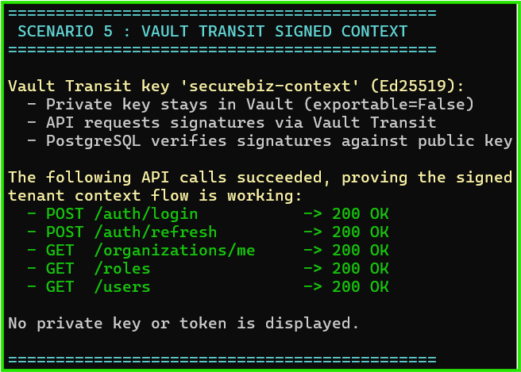 — Captured 2026-11-17

Status: **DEMONSTRATED**.

## 10. Scenario 8 — Authentication Error Handling and Account Enumeration

### Objective

Demonstrate the application's generic authentication failure behavior.

### Demonstration procedure

Submit two login requests:

1. An email address associated with no account.
2. A valid test email address with an incorrect password.

Expected behavior:

- Both requests are rejected with HTTP 401.
- Both use the generic `Invalid credentials.` response.
- The implementation performs a dummy Argon2 verification for an unknown email address.

This behavior reduces information disclosed through authentication errors.

It does not establish that response timing is statistically indistinguishable. A timing assessment would require separate measurements under controlled conditions.

## 11. Scenario 9 — Discussion Extension: LF COMPANY and Odoo

### Objective

Discuss possible future integration between SecureBiz-Lab and LF COMPANY's business-management environment.

The discussion may cover:

- Authentication and identity federation.
- Secure API communication.
- Organization and user mapping.
- Role and permission mapping.
- Audit logging.
- Controlled access to business-management functions.
- Secure exchange of operational data.

### Current implementation status

An Odoo integration is not currently implemented in SecureBiz-Lab.

This section is a discussion and architecture-planning extension only.

It must not be presented as an existing feature or as a completed integration.

Any future integration would require a separate design, authorization model, API contract, and security assessment.

## 12. Demonstration Evidence and Reporting

For each scenario, record:

- Scenario identifier.
- Date and environment.
- Test account identifier, without recording its password.
- API endpoint and HTTP method.
- Observed HTTP status.
- Expected behavior.
- Actual behavior.
- Pass, fail, or not executed.
- Supporting evidence (sanitized screenshots).

Never include:

- Raw access tokens.
- Raw refresh tokens.
- Passwords.
- Vault tokens.
- Private signing keys.
- Database credentials.
- Password hashes.

### 12.1 Evidence classification

| Label | Meaning |
|---|---|
| IMPLEMENTED | Present in source code or database migration |
| AUTOMATED CHECK | Covered by an automated test that has been executed |
| VERIFIED | Confirmed by a technical verification (e.g., read-only SQL query) |
| DEMONSTRATED | Observed during a controlled live demonstration |
| NOT EXECUTED | No execution evidence is available |

### 12.2 Verified and demonstrated results

| Verification | Method | Result | Label |
|---|---|---|---|
| Organization `Test Org` exists | SQL | `1a40e607-...` | VERIFIED |
| `demo-owner@...` user | SQL | UUID `27dc8c7b-...`, active | VERIFIED |
| `demo-member@...` user | SQL | UUID `949fd8ec-...`, active | VERIFIED |
| Role `owner` | SQL | UUID `b8fefee1-...`, `is_system = false` | VERIFIED |
| Role `member` | SQL | UUID `bbdf8919-...`, `is_system = false` | VERIFIED |
| Credentials Argon2id (owner) | SQL prefix | `$argon2id$` | VERIFIED |
| Credentials Argon2id (member) | SQL prefix | `$argon2id$` | VERIFIED |
| `test-user@test.com` preserved | SQL | unchanged | VERIFIED |
| Login owner API | API | HTTP 200, JWT, cookie | DEMONSTRATED |
| Login member API | API | HTTP 200, JWT, cookie | DEMONSTRATED |
| Invalid credentials | API | HTTP 401, `Invalid credentials.` | DEMONSTRATED |
| Protected endpoint | API | HTTP 200, filtered RLS response | DEMONSTRATED |
| Refresh rotation | API | HTTP 200, new token | DEMONSTRATED |
| Logout | API | HTTP 200, cookie cleared | DEMONSTRATED |
| Replay detection | API | HTTP 401, `Invalid refresh token.` | DEMONSTRATED |
| Multi-tenant valid context | API | HTTP 200, `Test Org` | DEMONSTRATED |
| Multi-tenant missing header | API | HTTP 400 | DEMONSTRATED |
| Multi-tenant invalid UUID | API | HTTP 422 | DEMONSTRATED |
| Multi-tenant unauthorized membership | API | HTTP 403 | DEMONSTRATED |
| RBAC owner `/roles` and `/users` | API | HTTP 200 | DEMONSTRATED |
| RBAC member `/roles` and `/users` | API | HTTP 200 | DEMONSTRATED |
| Vault Transit signed context | API | Implicit in all API calls | DEMONSTRATED |
| CI/CD workflows | GitHub Actions | - | NOT EXECUTED |
| Vault secret management (live) | CLI | - | NOT EXECUTED |

### 12.3 Capture status register

| ID | Scenario | File | Status |
|---|---|---|---|
| S1-LOGIN-SUCCESS | 3.1 | `captures/S1-login-success.png` | Captured 2026-11-15 |
| S1-LOGIN-SUCCESS-MEMBER | 3.1 | `captures/S1-login-success-member.png` | Captured 2026-11-15 |
| S1-LOGIN-INVALID | 3.2 | `captures/S1-login-invalid.png` | Captured 2026-11-16 |
| S1-PROTECTED-ENDPOINT | 3.3 | `captures/S1-protected-endpoint.png` | Captured 2026-11-16 |
| S1-REFRESH | 3.4 | `captures/S1-refresh-rotation.png` | Captured 2026-11-16 |
| S1-LOGOUT | 3.5 | `captures/S1-logout.png` | Captured 2026-11-16 |
| S2-REPLAY | 4 | `captures/S2-replay-detected.png` | Captured 2026-11-16 |
| S3-MULTI-TENANT | 5 | `captures/S3-multi-tenant.png` | Captured 2026-11-17 |
| S4-RBAC | 6 | `captures/S4-rbac.png` | Captured 2026-11-17 |

## 13. Cleanup

After the demonstration:

1. Log out from the test account.
2. Remove temporary cookie jars and other authentication artifacts.
3. Close temporary sessions.
4. Ensure that no secret values remain in terminal history, screenshots, or demonstration notes.
5. Preserve only sanitized evidence required for the final report.
6. Confirm that the test environment remains in a known state.

No production data or production credentials should be used during cleanup or testing.

## 14. Final Scope Statement

SecureBiz-Lab demonstrates a security-oriented API architecture combining JWT authentication, refresh-token rotation, Vault-backed signed tenant context, PostgreSQL Row-Level Security, RBAC permission evaluation, and CI/CD security checks.

The demonstrations must distinguish implemented controls from controls that have been independently executed and verified.

Odoo integration, unexecuted attack simulations, and unverified role-management operations remain outside the scope of demonstrated functionality.
